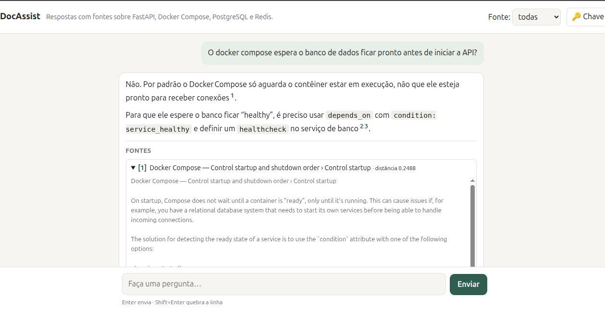
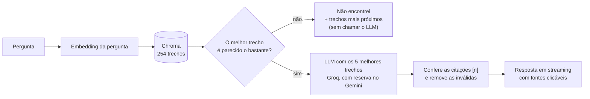
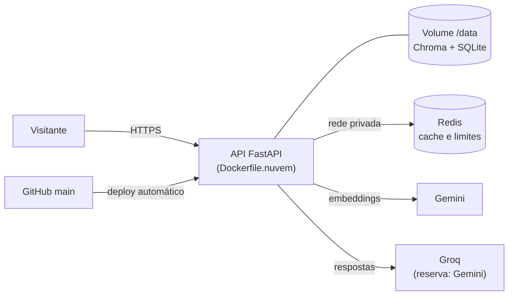

<div align="center">

# 📚 DocAssist

### Assistente RAG para documentação técnica: pergunta em português, resposta com fonte


### 💬 [Testar o chat agora](https://docassist-production-71453dfd.up.railway.app/chat) · sem cadastro e sem chave

</div>

---

## English summary

DocAssist is a **Retrieval-Augmented Generation (RAG)** assistant for technical documentation
(FastAPI, Docker Compose, PostgreSQL and Redis). You ask in Portuguese, it searches English
documentation and answers **only with what the documents say, citing the source of every
sentence**. When the answer is not in the documents, it says so instead of guessing.

- **Measured, not guessed:** a 60-question golden set drives every decision. Recall@5 went from
  0.82 to 0.94 and MRR from 0.63 to 0.87.
- **Honest answers:** 10 of 10 unanswerable questions refused, 6% false refusals; an LLM judge
  gave full marks for correctness and faithfulness and caught 30 of 30 planted errors.
- **Production on a free tier:** live on Railway with 512 MB of RAM, ~1 s to the first streamed
  word on the server, about US$ 0.01 per month.
- **Stack:** FastAPI, ChromaDB, Gemini embeddings, Groq LLMs, Redis, SQLite/PostgreSQL,
  Prometheus, Docker, GitHub Actions, Railway.

---

## 🎯 O problema

Documentação técnica é longa, fica em inglês e responde perguntas espalhadas em várias páginas.
Um chatbot genérico responde rápido, mas **inventa** com a mesma confiança com que acerta, e
não diz de onde tirou a resposta.

O DocAssist faz o contrário:

- **Responde só com o que está nos documentos**, e cada frase técnica traz a citação `[n]` do
  trecho de onde veio. Citações que não existem são removidas antes de chegar à tela.
- **Diz "não encontrei"** quando nenhum trecho é parecido o bastante com a pergunta, e mostra os
  trechos mais próximos. Isso acontece **antes** de chamar o LLM, então não gasta nada.
- **Pergunta em português, documentos em inglês:** o modelo de embedding é multilíngue.

Base atual: 18 páginas oficiais (FastAPI, Docker Compose, PostgreSQL e Redis), divididas em 254
trechos. A lista e as licenças estão em [`corpus/manifest.yaml`](corpus/manifest.yaml).

---

## 💬 Demo

**[docassist-production-71453dfd.up.railway.app/chat](https://docassist-production-71453dfd.up.railway.app/chat)**



Perguntas para testar:

- *O docker compose espera o banco de dados ficar pronto antes de iniciar a API?*
- *Qual comando do Redis remove o tempo de expiração de uma chave?*
- *Como declarar um parâmetro de query opcional no FastAPI?*
- *Qual é a capital da França?* (fora dos documentos: o sistema deve recusar)

A demo é aberta, com limites para proteger as cotas gratuitas das APIs: **3 perguntas por
minuto por pessoa** e **100 por dia somando todos os visitantes**. Ela pode levar alguns
segundos para responder na primeira pergunta, porque o serviço "dorme" quando ninguém usa.

---

## ⚙️ Como funciona



1. **Ingestão** (`POST /rag/ingest`): PDF, Markdown ou HTML são limpos, divididos por seção em
   trechos de até 250 tokens (com 30 de sobreposição) e transformados em vetores. Reenviar o
   mesmo arquivo não duplica nada.
2. **Busca:** a pergunta vira um vetor e o Chroma devolve os trechos mais próximos (distância
   cosseno, busca exata).
3. **Limiar:** se nem o melhor trecho é próximo o bastante, a resposta é "não encontrei". O
   limiar foi calibrado no golden set (veja [Resultados](#-resultados)).
4. **Geração:** o LLM recebe os 5 trechos e um prompt que proíbe informação de fora deles. Se o
   Groq atinge o limite de uso, a cadeia passa para o próximo modelo sem erro para o usuário.
5. **Validação:** citações para trechos inexistentes são removidas; resposta sem nenhuma citação
   válida é descartada e o usuário vê os trechos encontrados.
6. **Entrega:** a resposta chega aos pedaços (Server-Sent Events). Cada interação é gravada, e o
   usuário pode votar 👍/👎 com comentário.

---

## 📊 Resultados

Todas as decisões foram medidas num **golden set de 60 perguntas** escritas à mão: 50 com
resposta (factuais, de procedimento, de termo exato e que exigem dois documentos) e 10 sem
resposta nos documentos. O detalhe de cada experimento está em
[`docs/experimentos.md`](docs/experimentos.md).

### Recuperação: o trecho certo chega ao LLM?

| Experimento | Configuração | Recall@5 | MRR | Decisão |
| --- | --- | --- | --- | --- |
| E2 | e5-small multilíngue, chunks, só vetorial | 0,82 | 0,63 | base |
| E3 | + busca híbrida (BM25 + RRF) | 0,64 | 0,53 | ❌ não adotada |
| E4 | e5-small + reranker (20 candidatos) | 0,90 | 0,82 | ✅ versão local |
| E6 | reranker quantizado em int8 | 0,88 | 0,70 | ❌ mais lento e pior |
| **E7** | **embeddings do Gemini, sem reranker** | **0,94** | **0,87** | ✅ **versão na nuvem** |

*Recall@5: fração das perguntas em que o trecho com a resposta está entre os 5 primeiros.
MRR: quanto mais perto do 1º lugar ele aparece, mais perto de 1.*

### Geração: a resposta é honesta?

| Métrica | Resultado | Meta |
| --- | --- | --- |
| Perguntas sem resposta corretamente recusadas | **10 de 10** | ≥ 80% |
| Recusa indevida (havia resposta, mas recusou) | **3 de 50 (6%)** | ≤ 10% |
| Correção e fidelidade (LLM como juiz, notas 0 a 2) | **2,00 e 2,00** | — |
| Erros plantados de propósito que o juiz percebeu | **30 de 30** | — |

O juiz também foi testado: ele recebeu respostas estragadas de propósito (resposta de outra
pergunta, frase inventada, trechos trocados) para confirmar que a nota máxima não vinha de um
juiz que aprova tudo.

### Produção (Railway, plano gratuito)

| Métrica | Valor |
| --- | --- |
| Até o 1º pedaço da resposta, medido no servidor | **~1,0 s** (eram 5,3 s com o reranker local) |
| Memória da API | ~105 a 130 MB, de 512 MB |
| Custo estimado | ~US$ 0,01 por mês |

---

## 🧭 Decisões e trade-offs

- **Busca híbrida não adotada.** Ela ajuda quando pergunta e documento usam as mesmas palavras.
  Aqui a pergunta é em português e o documento em inglês: só os termos técnicos coincidem, e o
  BM25 empurrou para baixo bons resultados da busca vetorial (Recall@5 de 0,82 para 0,64). O
  código continua no repositório, documentado.
- **Reranker na versão local, Gemini na nuvem.** O reranker (um cross-encoder) melhorou muito
  a ordem dos trechos, mas o Prometheus mostrou que ele era **80% da espera** (4,75 s) e precisa
  do PyTorch, que não cabe em 512 MB. Os embeddings do Gemini deram qualidade igual ou melhor
  (E7) sem esse custo.
- **Quantização int8 rejeitada.** A expectativa era um reranker mais rápido; na prática ele ficou
  mais lento (6,0 s contra 5,6 s) e pior (MRR de 0,82 para 0,70). Otimização também se mede.
- **Recusar antes do LLM.** O limiar de distância foi calibrado no golden set: nas 60 perguntas,
  todas as sem resposta ficaram mais distantes que todas as com resposta. O valor escolhido
  (0,32) fica no meio desse intervalo, para não depender demais destas 60 perguntas.
- **SQLite na nuvem.** O plano gratuito da Railway permite um único volume por projeto. Ele
  ficou com a API (Chroma + SQLite), e o Postgres continua na versão local.

---

## 🧱 Arquitetura: local e nuvem

O mesmo código roda de dois jeitos, escolhidos só por variáveis de ambiente:

| | Local (`docker-compose.yml`) | Nuvem (`Dockerfile.nuvem`) |
| --- | --- | --- |
| Embeddings | `multilingual-e5-small`, na CPU | `gemini-embedding-001`, por API |
| Reranker | `mmarco-mMiniLMv2` (20 candidatos) | desligado |
| Banco | PostgreSQL 16 | SQLite no volume |
| Cache e limite de uso | Redis | Redis (rede privada) |
| Métricas | Prometheus | endpoint `/metrics` |
| Memória da API | ~570 MB | ~130 MB |



Cada merge na `main` passa pelo CI (lint + 212 testes) e é publicado sozinho na Railway. O passo a
passo do deploy está em [`docs/deploy.md`](docs/deploy.md).

---

## 🛠️ Stack

| Área | Ferramentas |
| --- | --- |
| API | FastAPI, Pydantic, Server-Sent Events, chave de API com limite por minuto (Redis) |
| RAG | ChromaDB (HNSW, cosseno), e5-small ou Gemini embeddings, cross-encoder, BM25 + RRF (experimental) |
| LLM | Groq (`gpt-oss-120b`, `qwen`) com cadeia de reserva para o Gemini |
| Avaliação | golden set de 60 perguntas, Recall@k, MRR, LLM como juiz, testes com respostas estragadas |
| Dados | SQLAlchemy, PostgreSQL ou SQLite, Redis |
| Observabilidade | Prometheus (tempo por etapa, respostas, bloqueios, votos) |
| Engenharia | Docker Compose, GitHub Actions (ruff + pytest), Railway, Docker Hub |

---

## 🏃 Como rodar localmente

Pré-requisitos: Docker com Compose e chaves gratuitas do [Groq](https://console.groq.com) e do
[Google AI Studio](https://aistudio.google.com) (Gemini).

```bash
# 1. Clonar e configurar
git clone https://github.com/Aline12Lima/DocAssist.git
cd DocAssist
cp .env.example .env          # preencha GROQ_API_KEY e GEMINI_API_KEY

# 2. Subir a API, o Postgres, o Redis e o Prometheus
docker compose up -d --build

# 3. Baixar os documentos e indexar
docker compose exec api python -m scripts.baixar_corpus
docker compose exec api python -m scripts.ingerir_corpus

# 4. Usar
#    Chat:     http://localhost:8000/chat
#    Swagger:  http://localhost:8000/docs
#    Métricas: http://localhost:9090
```

Os documentos não são versionados (alguns têm licença que não permite redistribuir): o script os
baixa das fontes oficiais.

Para simular a nuvem na sua máquina (imagem leve, limite de 512 MB e SQLite):

```bash
docker compose -f docker-compose.yml -f docker-compose.nuvem.yml up -d --build api-nuvem
# http://localhost:8001/chat
```

### Testes e avaliação

```bash
docker compose exec api pytest -q                                  # 212 testes, sem rede
docker compose exec api python -m evals.run_eval --nome teste --modo chunks --modelo e5small --reranker
docker compose exec api python -m scripts.perguntar --golden --nome teste   # respostas do golden set
docker compose exec api python -m evals.julgar --respostas evals/reports/<arquivo>.jsonl --nome teste
```

---

## 🔌 Endpoints principais

| Método | Rota | Para quê | Acesso |
| --- | --- | --- | --- |
| `POST` | `/rag/ask/stream` | Pergunta com resposta em streaming (SSE) | público, com limite |
| `POST` | `/rag/ask` | Pergunta com a resposta inteira (JSON) | público, com limite |
| `POST` | `/rag/feedback` | Voto 👍/👎 numa resposta | público |
| `GET` | `/rag/documents` | Documentos indexados | público |
| `POST` | `/rag/ingest` | Envia um documento (PDF, MD ou HTML, ou por URL) | chave |
| `DELETE` | `/rag/documents/{id}` | Remove um documento | chave |
| `GET` | `/rag/interacoes` | Histórico de perguntas e respostas | chave |
| `GET` | `/rag/feedback/resumo` | Taxa de respostas úteis e últimos 👎 | chave |
| `GET` | `/metrics` | Métricas no formato do Prometheus | público |

A chave vai no cabeçalho `X-API-Key`. A documentação interativa completa fica em `/docs`.

---

## 🐛 Desafios e soluções

| Problema | Causa | Solução |
| --- | --- | --- |
| Perguntas em português não achavam os documentos em inglês | modelo de embedding só em inglês | `multilingual-e5-small`: Recall@5 de 0,41 para 0,82 |
| Resultados da busca mudavam entre execuções | busca aproximada do índice HNSW | `hnsw:search_ef=200`: busca exata, resultados reproduzíveis |
| Primeira resposta levava 5 s | reranker na CPU (80% do tempo) | embeddings do Gemini e reranker desligado na nuvem |
| HTTP 429 ao indexar com o Gemini | limite gratuito de tokens por minuto | limitador próprio (25 mil tokens/min) e espera pelo `retryDelay` |
| API não cabia no plano gratuito | PyTorch + modelos ≈ 570 MB | imagem leve sem PyTorch: ~130 MB |
| Plano gratuito com um volume só | Postgres e Chroma pediam um volume cada | SQLite e Chroma no mesmo volume |
| Primeira pergunta lenta em casa, rápida no servidor | DNS da rede doméstica perdia a 1ª consulta (5 s) | cliente passou a mostrar os tempos do servidor; separar rede de processamento |
| Resposta certa descartada em produção | o `gpt-oss` citou como `【2†L1-L3】` | validação aceita esse formato e o converte em `[2]` |
| Testes passavam no CI e falhavam na minha máquina | dependiam das chaves do `.env` local | fixture que fixa a configuração em todo teste |
| `numpy 1.24` quebrou o ChromaDB | `np.float` removido | `numpy==1.23.5` fixado |

---

## 📁 Estrutura

```
app/
├── routers/rag.py           # endpoints do RAG (ask, stream, ingest, feedback...)
├── services/rag/            # parsers, chunker, embeddings, busca, pipeline, citações
├── services/llm/            # provedores (Groq, Gemini) e cadeia de reserva
├── services/avaliacao/      # LLM como juiz, concordância, respostas estragadas
├── services/seguranca.py    # chave de API, demo pública e limites de uso
├── static/chat.html         # interface de chat (HTML + JS, sem framework)
└── tests/                   # 212 testes (LLM, embedding e Redis simulados)
corpus/manifest.yaml         # documentos, fontes e licenças
evals/                       # golden set, avaliação, juiz e relatórios
prompts/                     # prompts versionados (answer_v2, judge_v1...)
docs/                        # escopo, experimentos e deploy
Dockerfile · Dockerfile.nuvem · docker-compose.yml · docker-compose.nuvem.yml
```

---

## 🕰️ Histórico

O projeto começou como **NLP Portfolio API**: uma API com 4 modelos do HuggingFace (sentimento,
entidades nomeadas, tradução e embeddings), cache no Redis e deploy com CI/CD. Ele foi renomeado para
DocAssist quando o foco passou a ser o RAG. Os endpoints de NLP continuam na versão local
(`/nlp/...`). O planejamento completo, fase por fase, está em
[`docs/escopo.md`](docs/escopo.md).

---

## 👤 Autora

**Aline Lima**

- GitHub: [@Aline12Lima](https://github.com/Aline12Lima)
- LinkedIn: [Aline Lima](https://www.linkedin.com/in/aline-l-397a84202/)

Licença MIT.
